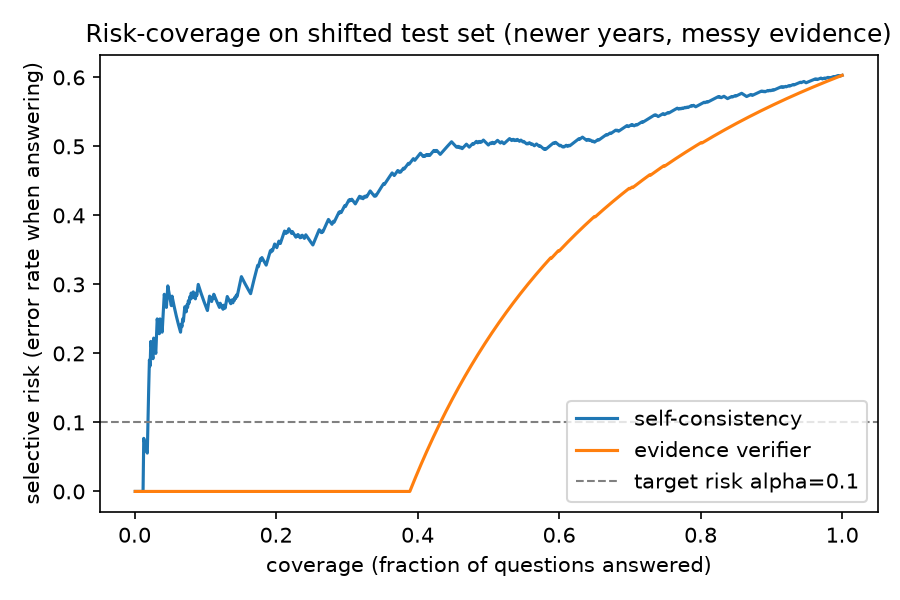

# finverify

**When should a financial research agent refuse to answer?**
Uncertainty-aware verification with finite-sample abstention guarantees, under evidence that is noisy, contradictory or incomplete, and under distribution shift.

## Question

LLM research agents answer questions from retrieved evidence. In finance that evidence is often noisy, contradictory (an analyst note disagrees with the 10-K) or missing. We ask:

> Can we decide when an agent should **answer or abstain** so that the error rate among answered questions stays below a target α, with a statistical guarantee, and does that guarantee survive when evidence quality shifts between calibration and deployment?

## Pipeline

```
SEC EDGAR XBRL facts ──► questions + evidence under 4 conditions ──► agent (K samples)
   (exact ground truth)    clean / noisy / contradictory / incomplete        │
                                                                             ▼
          accept / abstain ◄── threshold from Learn-then-Test ◄── uncertainty signals
                                (global or per evidence group)     self-consistency + evidence verifier
```

| Module | What it does |
|---|---|
| `finverify/data.py` | Pulls audited annual numbers (revenue, net income, operating income, R&D, total assets, cash) for 20 large US companies from SEC EDGAR `companyfacts`. Keeps restatement history. Includes an offline synthetic generator. |
| `finverify/evidence.py` | Builds a question per fact plus evidence passages under 4 conditions, with hard distractors (same company, same concept in another year or another concept in the same year). |
| `finverify/agent.py` | `ExtractiveAgent`: an offline retrieve-then-read baseline. `LLMAgent`: any OpenAI-compatible endpoint (OpenAI, Azure OpenAI, Ollama, vLLM). Both return K sampled answers. |
| `finverify/uncertainty.py` | Signals: self-consistency across samples, plus an evidence verifier (is the answer supported by a passage about the same concept and period? do relevant passages contradict each other? is the support from a trusted source?). A small logistic model maps signals to P(correct). |
| `finverify/conformal.py` | Threshold selection: a naive empirical threshold, **Learn-then-Test** (binomial p-values with fixed-sequence testing), and **group-wise (Mondrian) LTT** per observable evidence state. |
| `finverify/experiment.py` | Two regimes, *exchangeable* and *shift* (calibrate on ≤2018, mostly clean evidence; test on ≥2019, mostly contradictory or incomplete), repeated over random splits. |

## Guarantee

For threshold λ, selective risk is R(λ) = P(wrong | answered). LTT tests H₀: R(λ) > α with an exact binomial p-value and walks from conservative to permissive thresholds, stopping at the first failure. If calibration and test data are exchangeable:

  P( R(λ̂) ≤ α ) ≥ 1 − δ

Group-wise LTT runs this inside each evidence group g with δ/|G|. Every group's risk is then ≤ α at the same time, so the **overall** risk stays ≤ α under *any* change in the mix of groups. That is exactly the shift we induce. It does **not** protect against shift *within* a group; that is the open problem.

## Run it

```bash
python -m venv .venv
.venv\Scripts\activate            # macOS/Linux: source .venv/bin/activate
pip install -r requirements.txt
set SEC_USER_AGENT=YourName your.email@example.com   # SEC asks clients to identify themselves
python run_experiment.py          # real EDGAR data, offline agent, ~1 min
python run_experiment.py --source synthetic          # no network
pytest
```

With an LLM (it costs money, so start small):

```bash
set LLM_BASE_URL=https://api.openai.com/v1      # or http://localhost:11434/v1 for Ollama
set LLM_MODEL=gpt-4o-mini
set LLM_API_KEY=...
python run_experiment.py --agent llm --max-facts 150 --k 5 --out results_llm
```

Outputs: `results/summary.md` (tables), `results/risk_coverage.png`, `results/all_splits.csv`.

## Results (first run: 1,694 EDGAR facts, 20 companies, 2010–2026, 6,776 questions, 200 splits, α = δ = 0.1)

Agent accuracy collapses as evidence degrades: clean 91%, noisy 76%, contradictory 43%, incomplete 2%.

| regime | method | coverage | selective risk | P(risk > α) |
|---|---|---|---|---|
| exchangeable | always answer | 1.00 | 0.47 | 1.00 |
| exchangeable | verifier + naive threshold | 0.58 | 0.09 | **0.30** |
| exchangeable | verifier + LTT | 0.56 | 0.07 | 0.07 ✓ |
| exchangeable | verifier + group-wise LTT | 0.49 | 0.00 | 0.00 ✓ |
| shift | self-consistency + LTT | 0.30 | 0.41 | **0.99** |
| shift | verifier + LTT | 0.66 | 0.39 | **1.00** |
| shift | verifier + group-wise LTT | 0.25 | 0.00 | 0.00 ✓ |

Findings:
1. **Self-consistency is not enough.** When evidence is contradictory or missing, the agent is consistently wrong; on the shifted test set self-consistency can't get selective risk below 10% at any useful coverage (see the plot).
2. **Naive thresholds break the target** in 30% of splits even with no shift. LTT holds it (7% ≤ δ).
3. **Under evidence-quality shift, global LTT fails every time** (risk ~0.39 against a 0.10 target). **Group-wise LTT keeps its guarantee** and answers about 25% of questions, close to the share of the shifted test set whose evidence actually supports an answer.

Caveat: the "supported" group has almost no errors because passages are templated, so the near-zero risk is optimistic. See Limitations.



Full tables: [`results/summary.md`](results/summary.md).

## Limitations (be upfront about these in interviews)

- Evidence passages are **templated** from XBRL facts, so the verifier's string matching is easier than on real filing text. The next step is real 10-K passages via EDGAR full-text search, with an LLM-based verifier.
- The offline agent is lexical, not an LLM. The LLM agent is implemented but its results are not reported yet.
- Group-wise guarantees cover shifts in the *mix* of evidence states, not shift *inside* a state.

## Next steps

1. Run `LLMAgent` (a small open model through Ollama is free) and compare its self-consistency with the extractive baseline.
2. Replace templated passages with real filing excerpts; add an LLM verifier as a feature.
3. Handle within-group shift with weighted conformal (covariate-shift weights) or online/adaptive conformal over fiscal years.
4. Causal check: does the verifier signal stay predictive after conditioning on company and year?

## Related work

- Angelopoulos, Bates, Candès, Jordan, Lei. *Learn then Test: Calibrating Predictive Algorithms to Achieve Risk Control* (2021).
- Vovk et al. Mondrian conformal prediction; Tibshirani et al. *Conformal Prediction Under Covariate Shift* (2019); Gibbs & Candès, *Adaptive Conformal Inference Under Distribution Shift* (2021).
- MSR India: *Rethinking LLM Verification: Evidence Structure, Uncertainty, and Selective Refinement* (2026); *interwhen: test-time verification for reasoning models* (2026); *Characterizing Deep Research* (ICLR 2026).
