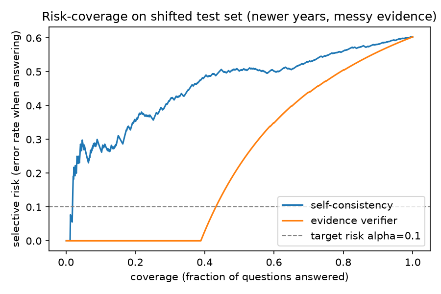

# Results

Config: `{"source": "edgar", "agent": "extractive", "evidence": "template", "keep_unverified_labels": false, "answers": null, "k": 10, "alpha": 0.1, "delta": 0.1, "reps": 200, "max_facts": 0, "seed": 0, "out": "results", "n_train": 300, "n_cal": 500, "n_test": 800, "n_facts": 1694, "n_items": 6776}`

## Agent behaviour by evidence condition

| condition | n | agent_accuracy | mean_self_consistency | unanimous_but_wrong | conflict_or_untrusted |
|---|---|---|---|---|---|
| clean | 1694 | 0.911 | 0.658 | 0.000 | 0.000 |
| noisy | 1694 | 0.760 | 0.457 | 0.000 | 0.000 |
| contradictory | 1694 | 0.425 | 0.486 | 0.000 | 1.000 |
| incomplete | 1694 | 0.016 | 0.488 | 0.002 | 0.000 |

## Accept/abstain policies (alpha=0.1, delta=0.1, 200 random splits)

- **coverage**: fraction of test questions answered
- **selective_risk**: error rate among answered questions (target <= alpha)
- **violation_rate**: fraction of splits where selective risk > alpha (LTT promises <= delta when exchangeable)
- **answered_unanswerable**: fraction of questions with no answer in the evidence that were answered anyway

| regime | method | coverage | selective_risk | violation_rate | answered_unanswerable |
|---|---|---|---|---|---|
| exchangeable | always answer | 1.000 | 0.470 | 1.000 | 1.000 |
| exchangeable | self-consistency + naive | 0.056 | 0.086 | 0.460 | 0.021 |
| exchangeable | self-consistency + LTT | 0.000 | 0.000 | 0.000 | 0.000 |
| exchangeable | verifier + naive | 0.577 | 0.089 | 0.300 | 0.000 |
| exchangeable | verifier + LTT | 0.563 | 0.066 | 0.065 | 0.000 |
| exchangeable | verifier + group-wise LTT | 0.491 | 0.002 | 0.000 | 0.000 |
| shift | always answer | 1.000 | 0.598 | 1.000 | 1.000 |
| shift | self-consistency + naive | 0.359 | 0.437 | 1.000 | 0.296 |
| shift | self-consistency + LTT | 0.296 | 0.406 | 0.985 | 0.236 |
| shift | verifier + naive | 0.781 | 0.483 | 1.000 | 0.559 |
| shift | verifier + LTT | 0.658 | 0.388 | 1.000 | 0.219 |
| shift | verifier + group-wise LTT | 0.250 | 0.000 | 0.000 | 0.000 |

