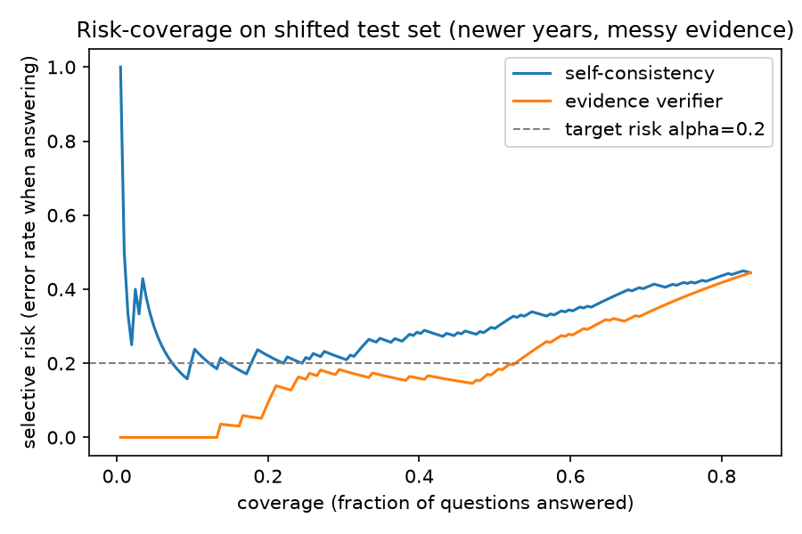

# Results

Config: `{"source": "edgar", "agent": "llm", "evidence": "10k", "keep_unverified_labels": false, "answers": "results_10k_llm/answers_qwen2.5_3b.jsonl", "k": 3, "alpha": 0.2, "delta": 0.1, "reps": 200, "max_facts": 120, "seed": 0, "out": "results_10k_llm/alpha_0.20", "n_train": 66, "n_cal": 100, "n_test": 100, "n_facts": 120, "n_items": 400}`

## Agent behaviour by evidence condition

| condition | n | agent_accuracy | mean_self_consistency | unanimous_but_wrong | conflict_or_untrusted |
|---|---|---|---|---|---|
| clean | 100 | 0.720 | 0.867 | 0.130 | 0.000 |
| noisy | 100 | 0.660 | 0.900 | 0.250 | 0.000 |
| contradictory | 100 | 0.490 | 0.847 | 0.310 | 0.250 |
| incomplete | 100 | 0.090 | 0.510 | 0.380 | 0.000 |

## Accept/abstain policies (alpha=0.2, delta=0.1, 200 random splits)

- **coverage**: fraction of test questions answered
- **selective_risk**: error rate among answered questions (target <= alpha)
- **violation_rate**: fraction of splits where selective risk > alpha (LTT promises <= delta when exchangeable)
- **answered_unanswerable**: fraction of questions with no answer in the evidence that were answered anyway

| regime | method | coverage | selective_risk | violation_rate | answered_unanswerable |
|---|---|---|---|---|---|
| exchangeable | always answer | 0.832 | 0.410 | 1.000 | 0.548 |
| exchangeable | self-consistency + naive | 0.000 | 0.000 | 0.000 | 0.000 |
| exchangeable | self-consistency + LTT | 0.000 | 0.000 | 0.000 | 0.000 |
| exchangeable | verifier + naive | 0.491 | 0.176 | 0.295 | 0.231 |
| exchangeable | verifier + LTT | 0.072 | 0.029 | 0.045 | 0.039 |
| exchangeable | verifier + group-wise LTT | 0.005 | 0.004 | 0.015 | 0.004 |
| shift | always answer | 0.801 | 0.534 | 1.000 | 0.532 |
| shift | self-consistency + naive | 0.119 | 0.087 | 0.170 | 0.078 |
| shift | self-consistency + LTT | 0.007 | 0.005 | 0.010 | 0.004 |
| shift | verifier + naive | 0.620 | 0.404 | 0.995 | 0.449 |
| shift | verifier + LTT | 0.347 | 0.231 | 0.690 | 0.207 |
| shift | verifier + group-wise LTT | 0.125 | 0.087 | 0.250 | 0.059 |

