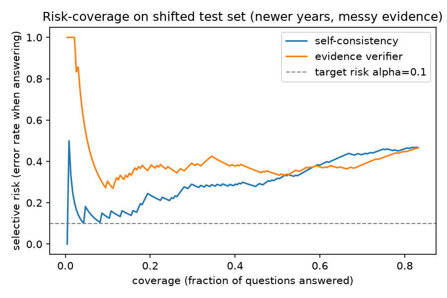

# Results

Config: `{"source": "edgar", "agent": "llm", "evidence": "10k", "k": 3, "alpha": 0.1, "delta": 0.1, "reps": 200, "max_facts": 120, "seed": 0, "out": "results_10k_llm", "n_train": 73, "n_cal": 110, "n_test": 110, "n_facts": 120, "n_items": 440}`

## Agent behaviour by evidence condition

| condition | n | agent_accuracy | mean_self_consistency | conflict_detected |
|---|---|---|---|---|
| clean | 110 | 0.673 | 0.852 | 0.000 |
| noisy | 110 | 0.645 | 0.897 | 0.000 |
| contradictory | 110 | 0.473 | 0.833 | 0.000 |
| incomplete | 110 | 0.100 | 0.524 | 0.000 |

## Accept/abstain policies (alpha=0.1, delta=0.1, 200 random splits)

- **coverage**: fraction of test questions answered
- **selective_risk**: error rate among answered questions (target <= alpha)
- **violation_rate**: fraction of splits where selective risk > alpha (LTT promises <= delta when exchangeable)
- **answered_unanswerable**: fraction of questions with no answer in the evidence that were answered anyway

| regime | method | coverage | selective_risk | violation_rate | answered_unanswerable |
|---|---|---|---|---|---|
| exchangeable | always answer | 0.828 | 0.434 | 1.000 | 0.565 |
| exchangeable | self-consistency + naive | 0.000 | 0.000 | 0.000 | 0.000 |
| exchangeable | self-consistency + LTT | 0.000 | 0.000 | 0.000 | 0.000 |
| exchangeable | verifier + naive | 0.016 | 0.095 | 0.200 | 0.014 |
| exchangeable | verifier + LTT | 0.000 | 0.000 | 0.000 | 0.000 |
| exchangeable | verifier + group-wise LTT | 0.000 | 0.000 | 0.000 | 0.000 |
| shift | always answer | 0.795 | 0.549 | 1.000 | 0.550 |
| shift | self-consistency + naive | 0.003 | 0.002 | 0.005 | 0.002 |
| shift | self-consistency + LTT | 0.000 | 0.000 | 0.000 | 0.000 |
| shift | verifier + naive | 0.159 | 0.377 | 0.735 | 0.146 |
| shift | verifier + LTT | 0.000 | 0.000 | 0.000 | 0.000 |
| shift | verifier + group-wise LTT | 0.000 | 0.000 | 0.000 | 0.000 |

